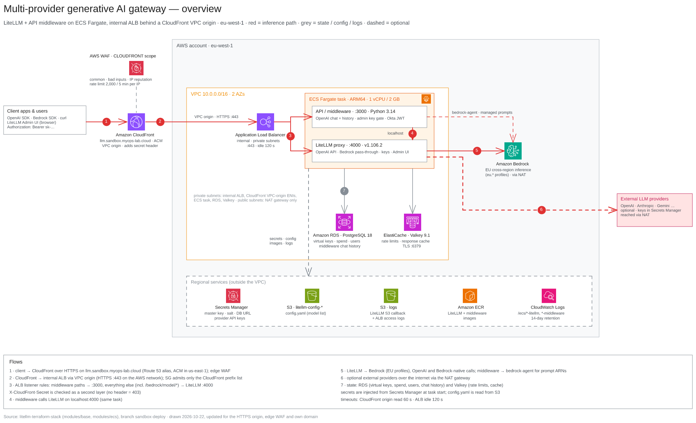

# Architecture diagrams

Diagrams of the ECS deployment of `litellm-terraform-stack` as configured on the
`sandbox-deploy` branch (eu-west-1, own domain `llm.sandbox.example.com`, edge WAF on CloudFront, CloudFront VPC origin to an internal ALB over HTTPS). They are drawn from
the Terraform and middleware code, not from a live account. Drawn 2026-10-22; updated the same day for the HTTPS origin, edge WAF, own domain, per-AZ NAT and CPU-only scaling.

| Diagram | What it shows |
|---|---|
| [`01-overview`](01-overview.png) | End-to-end request flow: clients → CloudFront with the edge WAF → VPC origin (HTTPS) → internal ALB → the Fargate task (middleware + LiteLLM) → Bedrock or external providers, plus RDS, Valkey and the regional services. |
| [`02-network`](02-network.png) | The VPC: two AZs, public and private /19 subnets, the internal ALB and CloudFront VPC-origin ENIs in the private subnets, single NAT (one per AZ with `NAT_GATEWAY_PER_AZ`), S3 gateway endpoint, conditional interface endpoints, route tables and the security-group chain. |
| [`03-request-routing`](03-request-routing.png) | ALB listener rules in priority order (P20–P27 middleware paths → :3000, P90 everything else including the Bedrock pass-through → :4000, default 403), the CloudFront secret header, the other listener modes, the admin-only `/key/generate` gate, and how master keys, virtual keys and Okta JWTs are handled. |
| [`04-sandbox-vs-production`](04-sandbox-vs-production.png) | Side by side: `envs/sandbox.env`, the settings `envs/production.env` changes, and production in its own AWS account (own domain with stack-issued certificates, SSO, 2–6 tasks, Multi-AZ RDS, 2 Valkey nodes, one NAT per AZ). |

Each diagram is stored three ways:

- `<name>.excalidraw`: the editable source
- `<name>.png`: raster export, for READMEs and slides
- `<name>.svg`: vector export

## Editing

1. Open the `.excalidraw` file in [excalidraw.com](https://excalidraw.com) (File → Open)
   or in VS Code with the
   [Excalidraw extension](https://marketplace.visualstudio.com/items?itemName=pomdtr.excalidraw-editor).
   The AWS icons are embedded in the file, so nothing else has to be installed.
2. Edit, then save the `.excalidraw` file.
3. Re-export the PNG and SVG with the same names (excalidraw.com: menu → Export image,
   background on, scale 1×) and commit all three files together. The
   [mcp_excalidraw](https://github.com/yctimlin/mcp_excalidraw) canvas server can do this
   headlessly: `POST /api/files` with the scene's `files`, `POST /api/elements/sync` with its
   `elements`, then `POST /api/export/image`. A browser must be connected to the canvas, or
   the embedded icons are left out.

## Conventions

The style follows the house style of the Bizibox diagrams repo:

- Helvetica throughout. Title 28 px, subtitle and legend 15 px, labels 11–13 px.
- Boxes: AWS account in grey (`#adb5bd` / `#f8f9fa`), VPC with an orange outline
  (`#f08c00`), public subnets in blue (`#1971c2` / `#e7f5ff`), private subnets in green
  (`#2f9e44` / `#ebfbee`). A dashed box means conditional, optional or scale-out only.
- Arrows are right-angled only. Red is the inference request path, grey is
  state, config, logs or egress. Numbered badges refer to the Flows box.
- Icons come from the official AWS Architecture Icons, via
  [stv-io/aws-excalidraw-icons](https://github.com/stv-io/aws-excalidraw-icons).

When the Terraform changes (ALB rules, subnets, sizing), update the matching diagram
and its date in the footer.
